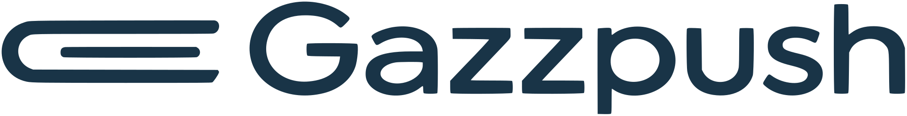
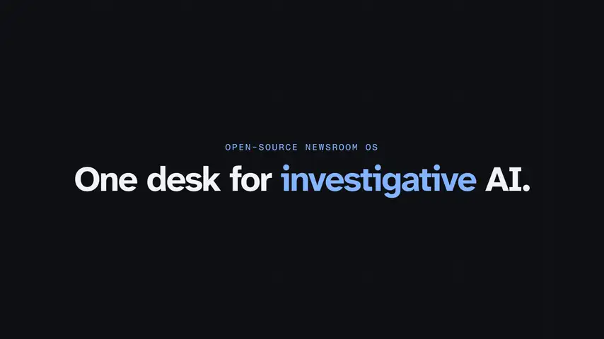
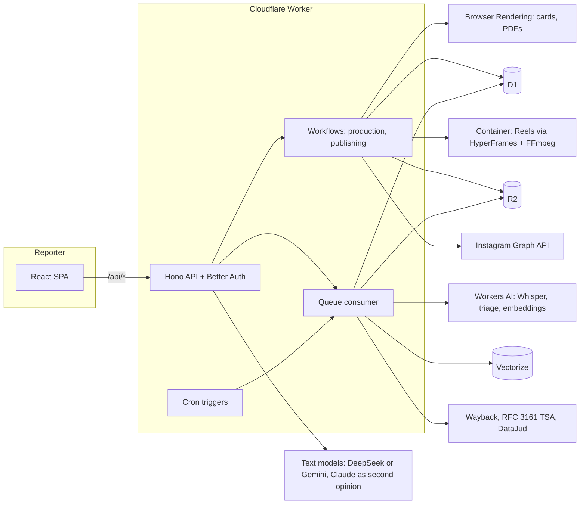

<p align="center">
  <picture>
    <source media="(prefers-color-scheme: dark)" srcset="web/public/marca/lombada/assinatura-clara.svg">
    
  </picture>
</p>

<p align="center">
  <strong>An open-source writing assistant for investigative journalism.</strong><br>
  Write the story with your sources beside the text and an editor's questions in the margin,
  and keep a record of how it was reported that holds up.
</p>

<p align="center">
  <a href="LICENSE"></a>
  <a href="https://github.com/CitadelAgency/gazzpush/actions/workflows/ci.yml"></a>
  
</p>

<p align="center">
  <br>
  <sub><a href="https://github.com/CitadelAgency/gazzpush/raw/main/docs/media/gazzpush-teaser.mp4">Download 1080p MP4 with audio (0:48)</a></sub>
</p>

---

Gazzpush helps journalists write investigative stories: the kind that have to hold up to an editor, to a lawyer, to a
court. You write in an editor that keeps your material next to the draft: the links, documents, interview recordings
and clippings of the story, searchable in one place and ready to quote with their citation. While you write, it asks
the questions an experienced editor would put in the margin: who gave this number, did you reach the other side, is
this quote in any source. It finds the passage in your dossier that supports each sentence, so the questions point at
what is actually missing.

Around the writing, it helps with the reporting: asking questions of long PDFs, transcribing interviews, drafting
freedom of information requests, sending the right of reply and tracking deadlines. When the story is out, it keeps
watching its sources, can export the whole reporting trail with cryptographic timestamps, and can turn the story into
Instagram carousels and Reels that carry their sources with them.

> **It helps you write; it never writes for you.** Gazzpush uses language models to *find* things: which source
> supports a sentence, which page answers a question. Nothing a model says is written into your text, and no answer is
> trusted on its own: every citation is matched letter by letter against the stored source, and every number is
> recomputed in code.

## Contents

- [What it does](#what-it-does)
- [How it works](#how-it-works)
- [Quick start](#quick-start)
- [Deploy to your Cloudflare account](#deploy-to-your-cloudflare-account)
- [Documentation](#documentation)
- [Project status](#project-status)
- [Contributing](#contributing)
- [License](#license)

## What it does

### Write

The **story desk** is a rich-text editor built around the material of the story.

- **Material on the side.** The story's links, PDFs, recordings and clippings, plus sources saved from earlier
  stories, in a column next to the draft with one search across all of them. Read a source beside your text, clip a
  passage, and insert it as it is, with its citation.
- **Interview quotes.** Search the transcripts of your recordings and drop a passage of speech into the text.
- **Cite as you type.** `@` cites from the dossier; pasting a bare link offers to add it to the dossier.
- **A blue-pencil reviewer.** One question per paragraph in the margin, the one an experienced editor would ask
  first. The questions are fixed in code: they cost nothing, cannot hallucinate, and read the same for everyone.
- **A second read.** On request, a model acting as an editor points at the opening, an unanswered question, what
  could go. Each note points to a passage; you decide.
- **Focus mode, autosave and versions.** Earlier versions can be viewed and restored at any time.
- **A style guide** for the outlet, whose rules point things out and never rewrite.

### Check as you write

The questions in the margin come from checks that run on each paragraph you finish.

- **Claim-by-claim checking against a dossier.** Each paragraph is checked against the links, documents, replies and
  FOI responses you attached. A claim is marked *supported* only when the code finds the cited passage, verbatim, in the
  stored copy of the source.
- **Numbers recomputed by code.** Percent changes, shares of a total and sums are recalculated deterministically:
  *"From 10,000,000 to 15,000,000 is a 50% increase, not 40%."*
- **Quotes that must exist.** A quotation that is in neither the dossier nor a recording is flagged.
- **Legal risk flags.** Accusations without a conviction or without the other side, and exposure of victims or
  minors, block publication until someone resolves them or an editor signs off.
- **A second opinion.** Risky paragraphs can go to a second model from a different vendor. Topics that some models are
  known to soften are routed to it entirely. When the two disagree, the flag stays open.
- **Source strength and an audit view.** Official documents count as strong evidence, anonymous sources as weak.
  The audit view breaks six months of flags down by month, topic and person, so you can see whether checking weighs
  more heavily on one side.

### Investigate

- **Ask the document.** Upload a PDF of up to 500 pages and ask it questions. Hybrid keyword and semantic search finds
  the pages, and an answer is shown only if its quoted passage is really on the cited page. Otherwise the answer is
  *"I didn't find it in the document."*
- **Quotes against the tape.** Interview audio is transcribed with Whisper, and each quotation in the text is matched
  word by word against the transcript, with a timestamp you can play.
- **Freedom of information (Brazil).** Sentences that cite a public body without a source become draft requests under
  Brazil's Access to Information Law, with deadlines, holidays, appeals and complaints tracked to the day.
- **Court cases (Brazil).** Case numbers cited in a story are tracked through the CNJ's DataJud API, and new filings
  raise an alert.

### Defend

- **Right of reply.** Send the request by email from the app with a server-side timestamp, or copy it and record when
  and how it was sent. Replies land in the dossier automatically.
- **Wayback captures.** Every link in the dossier is archived on the Internet Archive.
- **Defense package.** One zip with every version of the text, the stored copy of each source, every reporting
  decision (who, what, when), every published post and a SHA-256 manifest timestamped under RFC 3161. You can
  [verify it with OpenSSL](docs/features/legal-shield.md), without Gazzpush.
- **A sheet for the lawyer.** A short PDF with only the risky sentences, their evidence and the reply.
- **"How we reported this."** An optional public page listing each sourced sentence with its passage and archive link.

### Follow up after publication

- **Living stories.** Alerts when a source changes or goes offline, when a person named in a story shows up in new
  coverage, when a cited court case moves, or when an FOI deadline is near.
- **Corrections and updates as first-class posts,** labelled by code and linked to the original.

### Distribute what you verified

- **From verified claims to carousels.** A story becomes an Instagram carousel built only from checked sentences. Each
  card keeps its source, and a final card links to the public sources page.
- **Reels** rendered from the same cards in a container, optionally narrated in your own voice. The narration is
  checked against the script for wrong numbers and names.
- **A monitored newsroom pipeline** for local and thematic outlets. Feeds are monitored and triaged into leads, and
  each piece passes deterministic validation (no sentence without a fact, no number, date or place outside the source)
  before a human approves it.
- **Account resilience.** Timestamped publication certificates, a takedown kit and an optional public backup page.

See the [feature reference](docs/features/README.md) for the details, limits and API of each area.

## How it works

Sources come in (links, PDFs, interview audio, feeds), get stored with a hash and an archive copy, and become the
dossier. Models are asked narrow questions about that dossier, and the code verifies each answer before anyone sees it.
People decide, every decision is logged, and the record can be exported and timestamped at any point.

Under the hood it is a TypeScript app (React front end, Hono API) that you deploy to your own Cloudflare account,
where it uses Cloudflare's managed storage, queues, AI inference, headless browsers and containers. There is no server
to maintain.



| Layer | Technology |
|---|---|
| Runtime | Cloudflare Workers (TypeScript), one Worker for API, cron, queue consumer and static assets |
| Web | React 19, React Router, TanStack Query, Tiptap editor, Tailwind CSS 4, Vite |
| API and auth | Hono with typed RPC client, Better Auth (email and password, optional Google) on D1 |
| Data | D1 (SQLite, with FTS5), R2 (raw sources, files, artwork), KV (config), Vectorize (dedupe, document search) |
| Orchestration | Queues (monitoring, transcription, archiving), Workflows (production, publishing), cron triggers |
| AI | DeepSeek or Gemini (drafting, checking), Anthropic Claude (second opinion), Workers AI (Whisper, triage, embeddings, vision) |
| Media | Browser Rendering (cards, PDFs), Cloudflare Containers with HyperFrames, headless Chrome and FFmpeg (Reels) |
| Trust | RFC 3161 timestamps (PKI.js), SHA-256 manifests, Internet Archive Save Page Now |

Read [docs/architecture.md](docs/architecture.md) for the data flow, the state machine and the design rules.

## Quick start

Requirements: Node.js 24, npm and a Cloudflare account. Workers AI, Browser Rendering and Vectorize have no local
emulator, so those bindings call your account even in development (run `npx wrangler login` once).

```sh
git clone https://github.com/CitadelAgency/gazzpush.git
cd gazzpush
npm ci
cp .dev.vars.example .dev.vars
```

Edit `.dev.vars`. At minimum, set `PUBLIC_BASE_URL=http://localhost:8787` and generate two different random values for
`BETTER_AUTH_SECRET` and `TOKEN_ENC_KEY`:

```sh
node -e "console.log(require('node:crypto').randomBytes(32).toString('base64url'))"
```

Then build and run:

```sh
npm run types              # generate worker-configuration.d.ts from wrangler.jsonc
npm run db:migrate:local   # create the local D1 database
npm run web:build          # build the React app into web/dist
npm run dev -- --local     # http://localhost:8787
```

Open <http://localhost:8787>, create the first account and then your first outlet. To draft and check text you need a
text-model key, either in `.dev.vars` (`DEEPSEEK_API_KEY` or `GEMINI_API_KEY`) or per outlet under
**Publication › AI keys**. See [docs/development.md](docs/development.md) for the full development loop and tests.

## Deploy to your Cloudflare account

The edition in this repository runs with `INSTALACAO_PROPRIA=1` (self-hosted): there is no billing, new outlets get an
unlimited plan, and each outlet can bring its own AI provider keys, stored encrypted.

In short: create the D1 database, KV namespace, R2 bucket, queues and Vectorize indexes, put their IDs in
`wrangler.jsonc`, set the secrets, then run `npm run web:build && npm run db:migrate && npm run deploy`. The step-by-step
guide, including the Reels container and optional integrations, is in [docs/self-hosting.md](docs/self-hosting.md).
Every environment variable is listed in [docs/configuration.md](docs/configuration.md).

## Documentation

| Guide | What's inside |
|---|---|
| [Self-hosting](docs/self-hosting.md) | Cloudflare resources, secrets, first deploy, custom domain, Reels container |
| [Configuration](docs/configuration.md) | Every binding and environment variable, required and optional |
| [Architecture](docs/architecture.md) | Request flow, state machine, queues and workflows, design rules |
| [Development](docs/development.md) | Local loop, tests, end-to-end tests, code conventions |
| [Feature reference](docs/features/README.md) | Story desk, legal shield, documents and recordings, living stories, pipeline, distribution |
| [Integrations](docs/integrations.md) | Google Docs, Stripe, email, DataJud |
| [Glossary](docs/glossary.md) | Portuguese terms that remain in the code (tables, routes, stored values) and their English meaning |
| [Design system](DESIGN.md) | Tokens, typography, layout and interaction rules for the web app |

## Project status

Gazzpush is in active development. Expect breaking changes until 1.0. Things to know before you adopt it:

- **Some names stay in Portuguese.** Functions, variables and comments are in English, but database tables, HTTP
  routes and stored values keep the Brazilian newsroom vocabulary (`pautas`, `pecas`, `textos`), because changing them
  would break stored data and external links. The UI is fully bilingual (English and Portuguese, per user), and
  published content can be in either language per outlet. The [glossary](docs/glossary.md) maps every Portuguese term
  that remains.
- **Some features are Brazil-specific.** FOI requests follow Brazil's Lei 12.527/2011, court tracking uses the CNJ's
  DataJud, and the local-news triage knows Brazilian municipalities (IBGE). Everything else is country-neutral.
- **Cloudflare-native.** The app relies on Workers, D1, R2, Queues, Workflows, Vectorize, Browser Rendering and
  Containers. There is no Docker Compose deployment.
- **Instagram is the publishing target.** Publishing goes through the Instagram Graph API, or manually from a phone.
  The investigative tools do not depend on it.
- **Third-party models.** Drafting and checking call external providers (DeepSeek or Gemini, optionally Anthropic).
  Their terms and data policies apply to the text you send.

## Contributing

Bug reports, fixes and documentation are welcome. Read [CONTRIBUTING.md](CONTRIBUTING.md) before opening a pull
request, and report security issues privately as described in [SECURITY.md](SECURITY.md).

## License

Gazzpush is free software under the [GNU Affero General Public License v3.0 only](LICENSE). If you run a modified
version as a network service, the AGPL requires you to offer its source code to its users. Copyright © 2026 Citadel
Tecnologia LTDA. See [NOTICE](NOTICE) for attribution and third-party notices.
