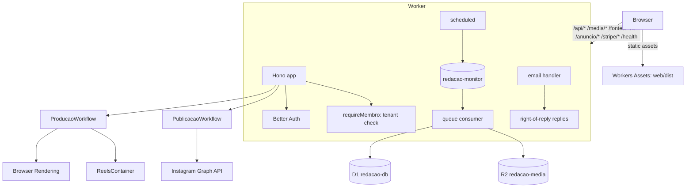

# Architecture

Gazzpush is one Cloudflare Worker. The same deployment serves the web app, the HTTP API, the cron triggers, the
queue consumer and two Workflows, and it renders artwork in Browser Rendering and video in a Cloudflare Container.
This page describes how the pieces fit and the rules the code follows. Words like *outlet*, *lead* and *piece* are
defined in the [glossary](glossary.md).

## Repository layout

```
src/                    Cloudflare Worker (TypeScript, no DOM)
  index.ts              entry point: public routes, /media, auth, queue, cron, email handlers
  env.ts                bindings, secrets and queue message types
  kernel/estados.ts     state machine for pieces, leads and documents
  shell/                HTTP layer: API routes (Hono), auth, tenancy, i18n
  lib/                  domain logic, mostly pure functions with unit tests
  monitor/              cron scheduler and queue consumer
  workflows/            Cloudflare Workflows: production, publishing, reconciliation
  templates/            HTML templates for cards, rendered in Browser Rendering
  reelsContainer.ts     Durable Object that fronts the Reels container
web/                    React single-page app (Vite)
  src/telas/            screens, one lazy chunk each
  src/casca/            app shell: sidebar, menus, command palette, shortcuts
  src/materia/          story desk panels: dossier, legal shield, documents, recordings
  src/kit/              UI kit components
  src/estilo/           design tokens and global CSS (see DESIGN.md)
  e2e/                  Playwright end-to-end tests
container/reels/        Dockerfile and server for Reels rendering (HyperFrames, Chrome, FFmpeg)
migrations/             D1 migrations, applied in order
test/                   Vitest suites running inside workerd
assets/fonts/           fonts bundled into the Worker for card rendering
scripts/                maintenance scripts (auth schema, municipalities data)
```

## Runtime topology



Static files are served by Workers Assets with `not_found_handling: single-page-application`. Only the paths listed in
`assets.run_worker_first` reach the Worker: the API, authenticated media, the health check and the public pages
(sources page, outlet backup page, advertiser approval, Stripe webhook).

### Cloudflare resources

| Binding | Resource | Used for |
|---|---|---|
| `DB` | D1 `redacao-db` | All metadata, FTS5 full-text index of document pages |
| `MEDIA` | R2 `redacao-media` | Raw fetched sources, extracted text, PDFs, audio, artwork, Reels, defense packages |
| `CONFIG` | KV namespace | Caches and cursors: neighborhood lists per municipality, reference-image URLs, Workflow reconciliation cursor |
| `MONITOR_QUEUE` | Queue `redacao-monitor` (DLQ `redacao-monitor-dlq`) | All background work (see below) |
| `PRODUCAO_WORKFLOW` | Workflow `redacao-producao` | Producing one round of a piece |
| `PUBLICACAO_WORKFLOW` | Workflow `redacao-publicacao` | Publishing an approved piece, optionally scheduled |
| `AI` | Workers AI | Triage, Whisper transcription, embeddings (bge-m3), image QA and vision |
| `BROWSER` | Browser Rendering | Card PNGs, PDFs, site reading for brand import, WAF fallback fetch |
| `DEDUPE` | Vectorize `redacao-dedupe` | Semantic dedupe of incoming news (1024 dims, cosine) |
| `DOCS_VETOR` | Vectorize `redacao-documentos` | Semantic search in uploaded PDFs, one namespace per file (optional) |
| `REELS` | Durable Object `ReelsContainer` + Container | Rendering Reels MP4s |
| `METRICS` | Analytics Engine `redacao_metrics` | Operational metrics |
| `EMAIL` | Email Service `send_email` | Right-of-reply emails (optional) |

The resource names keep the project's original codename, `redacao`. You can rename them, as long as `wrangler.jsonc`
matches.

## Background work

Three cron triggers drive scheduled work (`src/monitor/scheduled.ts`):

| Cron (UTC) | What it does |
|---|---|
| `*/15 * * * *` | Enqueue sources whose interval elapsed; reconcile Workflow instances; close stuck file processing and abandoned in-app recordings |
| `0 9 * * *` | Re-read dossier evidence to detect changed sources; enqueue court-case checks; sync FOI deadlines |
| `0 21 * * *` | Build the daily digest for outlets that enabled it |

Everything else goes through one queue, `redacao-monitor`, with a typed message union (`MonitorMessage` in
`src/env.ts`): `fonte`, `documento`, `resumo`, `autoral`, `evidencia`, `wayback`, `arquivo`, `gravacao`, `segmento`,
`narracao`, `processo`, `lai`, `certidao` and `raiox`. The consumer (`src/monitor/consumer.ts`) retries up to three
times, then dead-letters. Long-running file work records ownership (`arquivos.processando_em`) so a duplicate delivery
never processes the same file twice, and a failure is always written where the UI can show it.

## The newsroom pipeline

```
cron (15 min) → due sources → queue → fetch + parse (RSS or HTML) → document (D1) + raw (R2)
     → extract text → triage (constrained JSON schema) → facts with literal spans → dedupe → suggested lead

POST /api/t/:tenantId/pautas/:id/produzir → ProducaoWorkflow (instance <piece>-r<round>):
     load lead → draft (idempotent per version) → validate (up to 3 drafts) → illustrate → render → review

POST /api/t/:tenantId/pecas/:id/revisao {aprovar | reescrever | rejeitar}
     approve + manual account  → piece approved; someone posts from a phone and records the URL
     approve + connected account → PublicacaoWorkflow (<piece>-pub-<n>): wait until scheduled → publish
     rewrite                   → next round (at most 3 rounds per piece)
```

The Reels flow reuses the same machinery: a Reels piece copies an approved carousel, re-validates it, renders the
video in the container and goes through the same review and publishing steps.

### State machine

Status changes for pieces, leads and documents happen in exactly one place, `transitar` in `src/kernel/estados.ts`. It
holds the transition table, issues a conditional `UPDATE`, writes an event and applies any extra statements in the
same `DB.batch`, so a transition and its side effects are atomic. Enums live in code, not in SQLite `CHECK`
constraints.

| Entity | Transitions |
|---|---|
| Piece | `rascunho` → `revisao` → `aprovada` or `agendada` → `publicada`; `revisao` → `rascunho` (rewrite) or `rejeitada`; automatic steps may go to `falhou` |
| Lead | `sugerida` → `aceita` → `em_producao` → `concluida`; any open state → `descartada` |
| Document | `novo` → `triado` or `descartado` |

Workflow steps follow one replay rule: no writes outside `step.do`, and every step is idempotent by construction. A
draft that already exists for a version is returned without calling the model again, costs are added in the same
batch that writes the version, and transitions are no-ops when the entity is already in the target state. A
transition can also require that the piece still belongs to the running Workflow instance, so a replayed step from a
superseded round cannot touch it.

## The story desk

Outlets in `autoral` mode get the story desk (`/t/:veiculo/textos/:id`). Its API lives in `src/shell/textos.ts` and its
logic in `src/lib/mesa.ts` (checking), `src/lib/escudo.ts` (legal shield), `src/lib/documento.ts` (PDFs),
`src/lib/gravacao.ts` (recordings) and `src/lib/viva.ts` (alerts). The pattern is the same everywhere:

1. A model is asked a narrow question and must answer in a strict JSON shape.
2. The code verifies the answer against stored data: the passage must be in the source letter by letter, the page must
   be one that was sent, the arithmetic must add up.
3. Anything that does not verify is discarded or shown as *not checked*, with the reason. Nothing fails silently.
4. People make the decisions, and each decision is recorded with who and when.

Checking runs per block. Each editor block stores a content hash, and only blocks whose hash changed are sent to the
model. Up to four go in parallel with a shared prefix (dossier plus full text) to benefit from provider-side prompt
caching. Results stream back as NDJSON.

## Web app

- **Single-page app** built by Vite into `web/dist`, served as Worker assets from the same origin. No SSR.
- **Routing** with React Router in library mode, one lazy chunk per screen (`web/src/rotas.tsx`). The URL holds the
  outlet and the section.
- **Data** with TanStack Query and the Hono RPC client (`hc<AppType>`, imported as a type only). Query keys start with
  the tenant id.
- **Polling, not sockets.** Piece status comes from a light endpoint (`/api/t/:tenantId/pecas/:id/status`, D1 only),
  polled quickly while producing and slowly in review, and stopped in final states. Review decisions send the expected
  version and get `409` if someone else decided first.
- **Editor**: Tiptap (ProseMirror), loaded only on the story desk route. The server sanitizes documents to the allowed
  nodes (`src/lib/doc.ts`).
- **Styling**: Tailwind CSS 4 with the project's own tokens only (the default palette is removed). See
  [DESIGN.md](../DESIGN.md).
- **i18n**: every UI string is written as a pair, `t("Aprovar", "Approve")`, next to where it is used
  (`web/src/idioma.ts`, `src/shell/idioma.ts`). The client sends `x-idioma` with each request, and the API answers
  errors in that language.

## Security model

- **Authentication**: Better Auth on D1, with email and password plus optional Google. Session cookies are tied to the
  origin in `PUBLIC_BASE_URL`, so serve the app from a single host.
- **Tenancy**: every outlet route is `/api/t/:tenantId/...` and goes through `requireMembro`, which checks membership
  and role (`admin`, `editor`, `reporter`). The actor recorded on a decision always comes from the session, never from
  the request body. The test suite includes cross-tenant (IDOR) checks across the main route families.
- **Same-origin requests**: every `/api/*` request goes through `exigirMesmaOrigem` before the session check.
- **Media**: `/media/*` requires a session and tenant membership. Instagram fetches artwork through a short-lived
  signed URL created at publish time.
- **Secrets at rest**: social tokens and per-outlet AI keys are encrypted with `TOKEN_ENC_KEY`.
- **Admin**: `/api/admin/*` is limited to user ids in `ADMIN_USER_IDS`, not emails, because sign-up does not verify
  email addresses.
- **Untrusted input**: uploaded SVG logos are sanitized; URL fetches allow only public `http` and `https` addresses;
  uploads are size-checked while streaming and identified by magic bytes.

## Design rules

These rules keep the system small and auditable. Changes that break one should say why.

- **One Worker** until there is a concrete reason to split.
- **Deterministic validation before human review.** A sentence without a fact, or a number, date or place that is not
  in the source, fails the piece before anyone sees it.
- **Constrained generation.** Triage and extraction use restricted JSON schemas: the model can only choose passage ids,
  places and dates that literally exist in the text.
- **Never fail silently.** Every model outage, refusal or invalid answer becomes a visible state with a reason.
- **Avoid**: SSR in the Worker, a separate Pages project, Cloudflare Access as login, custom auth, JWTs in
  `localStorage`, WebSockets or Durable Objects to wait on long jobs, offline service workers, and Meta tokens
  outside the server.
